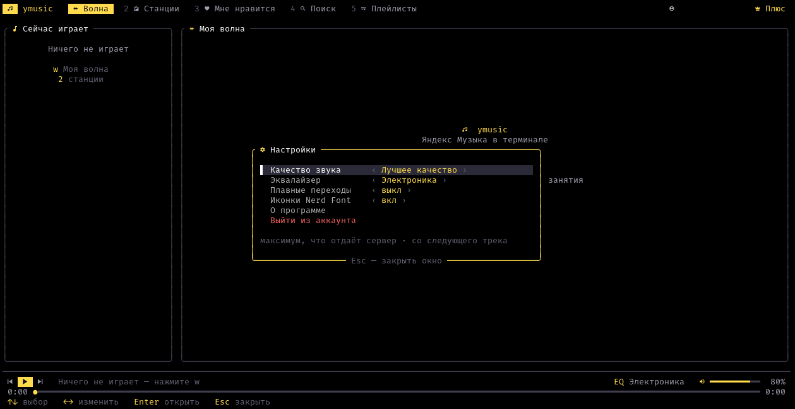

# ymusic-cli

**Яндекс Музыка в терминале.** Моя волна, лайки, станции по жанрам и настроениям, поиск — с понятными горячими клавишами.

<p align="center">
  
</p>

<table>
  <tr>
    <td align="center"><br><sub>Вкладка «Станции»</sub></td>
    <td align="center"><br><sub>Вкладка «Плейлисты»</sub></td>
  </tr>
  <tr>
    <td align="center"><br><sub>Вкладка «Поиск» без результатов</sub></td>
    <td align="center"><br><sub>Вкладка «Поиск» с результатами</sub></td>
  </tr>
  <tr>
    <td align="center"><br><sub>Окно настроек</sub></td>
    <td align="center"><br><sub>Окно помощи</sub></td>
  </tr>
</table>

> Иконки — из [Nerd Fonts](https://www.nerdfonts.com) (например, JetBrainsMono Nerd Font: `pacman -S ttf-jetbrains-mono-nerd`).
> Без Nerd Font выключите иконки в настройках (`o`), запускайте `ymusic --no-icons` или поставьте `"icons": false` в конфиге.

## Возможности

- **Моя волна** — персональный поток рекомендаций, как в приложении.
- **Лайки и дизлайки учитываются волной**: лайк/дизлайк сохраняется в аккаунт и отправляется
  волне как событие обратной связи (как и старт, пропуск и дослушивание трека), поэтому рекомендации подстраиваются
  прямо во время прослушивания. Дизлайкнутый трек пропускается и больше не попадётся.
- **Выбор волны**: Моя волна с настройками (Любимое / Незнакомое / Популярное, Бодрое / Весёлое / Спокойное / Грустное),
  жанры (рок, метал, русский рок, инди, электроника, рэп, джаз…), настроения, занятия (спорт, работа, сон…), эпохи.
  Список станций подгружается из вашего аккаунта.
- **Волна по треку** — `r` на любом треке запускает похожую музыку.
- **Мне нравится** — все лайкнутые треки, воспроизведение по порядку или вперемешку.
- **Плейлисты** — ваши плейлисты (включая загруженные треки): просмотр, воспроизведение по порядку или вперемешку,
  добавление и удаление треков, переименование и удаление плейлистов.
- **Поиск** треков: результаты подгружаются по мере прокрутки списка (в заголовке видно, сколько показано из найденных),
  а очередь, запущенная из поиска, сама пополняется следующими страницами.
- **Качество звука** — экономия трафика (≈64 кбит/с), или обычное (≈192 кбит/с); выбор запоминается.
- **Эквалайзер** — пресеты «Больше баса», «Вокал», «Рок», «Электроника», «Мягкий», «Колонки ноутбука»; выбор запоминается.
- **Плавные переходы** — трек плавно затихает в конце, следующий плавно нарастает в начале (3–15 секунд или выключено).
- **Доигрывать трек** — новый плейлист, альбом или волна не обрывают играющий трек: он остаётся первым в новой очереди
  и доигрывает, затем начинается новый список (`n` — перейти сразу).
- **Окно настроек** (`o`) — качество звука, эквалайзер, плавные переходы, «Доигрывать трек», «Меньше ИИ-музыки», API, картинку (обложка или спектр), иконки, «О программе»
  и выход из аккаунта. Значения меняются стрелками `←` / `→` и сразу применяются, выбор запоминается.
  Те же настройки, кроме «Меньше ИИ-музыки», лежат в `~/.config/ymusic/config.json` (`quality`, `eq`, `crossfade`, `finish_track`, `web_api`, `art`, `icons`);
  править его вручную лучше при закрытой программе: при выходе она сохраняет настройки и перезапишет файл.
- **Меньше ИИ-музыки** — реже подмешивать в рекомендации треки, созданные нейросетями. Это настройка аккаунта Яндекс Музыки,
  та же, что в официальном приложении: переключите её в одном месте — изменится и в другом. Действует на следующие порции волны.
- **API: мобильный или сайт** — запасной вариант на случай проблем с мобильным API: все запросы идут в API сайта
  music.yandex.ru (его методами, заголовками и подписью ссылок на звук). Возможности те же; переключается сразу, без перезапуска.
- **Обложки альбомов** прямо в терминале: sixel / kitty / iTerm2-протоколы (foot, kitty, WezTerm, Ghostty, Konsole, iTerm2),
  в остальных терминалах — цветными блоками.
- **Визуализатор спектра** вместо обложки (`o` → «Картинка»): 16 полос от 40 Гц до 16 кГц, синхронно со звуком.
- **Вход через браузер** (токен подхватывается автоматически) или по токену.
- Горячие клавиши работают и на **русской раскладке** (`д` = `l`, `т` = `n` и т. д.).
- **Свой плеер**: звук идёт в PipeWire или PulseAudio, а без них — прямо в устройство ALSA; mpv и другие программы
  не нужны.
- **Медиаклавиши и виджеты плеера** в окружении рабочего стола (MPRIS): пауза, переключение и перемотка, громкость,
  название, исполнитель, обложка и позиция трека. Работают и кнопки Bluetooth-наушников (через `mpris-proxy`).

> Для полных треков нужна подписка **Яндекс Плюс**, без неё API отдаёт только 30-секундные фрагменты.

Подробное описание всех экранов, окон, горячих клавиш и настроек — в [docs/FEATURES.md](docs/FEATURES.md).

## Установка

### Arch Linux (AUR)

```bash
yay -S ymusic-cli       # сборка из исходников
yay -S ymusic-cli-bin   # готовый статический бинарник из релиза GitHub
```

### Готовый бинарник

Статически собранный `ymusic` для Linux лежит в [релизах](https://github.com/iodnoorov/ymusic/releases/latest) —
работает на любом дистрибутиве, собирать из исходников не нужно и ничего доустанавливать тоже. Звук идёт в PipeWire или
PulseAudio, а если их нет — прямо в устройство ALSA.
Есть сборки для x86_64 и aarch64 (ARM64); сборка для aarch64 проверена на Raspberry Pi 3 (Debian 13, 64-бит).

```bash
V=3.0.0         # номер последнего релиза
A=$(uname -m)   # x86_64 или aarch64
curl -LO https://github.com/iodnoorov/ymusic/releases/download/v$V/ymusic-$V-$A-linux.tar.gz
curl -LO https://github.com/iodnoorov/ymusic/releases/download/v$V/ymusic-$V-$A-linux.tar.gz.sha256
sha256sum -c ymusic-$V-$A-linux.tar.gz.sha256
tar xzf ymusic-$V-$A-linux.tar.gz
install -Dm755 ymusic-$V-$A-linux/ymusic ~/.local/bin/ymusic
```

### Из исходников

Вручную из склонированного репозитория (собирает текущие исходники):

```bash
git clone https://github.com/iodnoorov/ymusic
cd ymusic/packaging/local
makepkg -si
```

После установки приложение запускается командой `ymusic` из любого терминала. Удалить: `sudo pacman -R ymusic-cli`.

### Из исходников (Cargo)

Нужны Rust ≥ 1.89 и компилятор C++ (для декодера fdk-aac).

```bash
cargo install --git https://github.com/iodnoorov/ymusic
# или
git clone https://github.com/iodnoorov/ymusic && cd ymusic
cargo build --release && ./target/release/ymusic
```

## Вход

```bash
ymusic login
```

Появится меню:

1. **Через браузер** — откроется отдельное окно браузера со страницей входа Яндекса. Войдите как обычно
   (пароль, QR, Яндекс ID) — токен подхватится автоматически, окно закроется само.
   Поддерживаются Firefox, Zen, LibreWolf, Floorp, Chromium, Chrome, Brave, Vivaldi, Edge, Яндекс Браузер.
   Используется браузер по умолчанию; другой можно указать: `YMUSIC_BROWSER=chromium ymusic login`.
   Окно запускается с временным чистым профилем, ваш основной профиль не затрагивается.
2. **По токену** — вставить OAuth-токен (или целиком URL с `access_token=`).

Без меню:

```bash
ymusic login --browser              # сразу через браузер
ymusic login --token y0_AgAAAA...   # готовый токен
YMUSIC_TOKEN=y0_... ymusic          # токен из переменной окружения (не сохраняется)
ymusic whoami                       # проверить аккаунт
ymusic logout                       # удалить токен
```

<details>
<summary>Как получить токен вручную</summary>

Откройте <https://oauth.yandex.ru/authorize?response_type=token&client_id=23cabbbdc6cd418abb4b39c32c41195d>,
войдите — браузер перейдёт на `https://music.yandex.ru/#access_token=...&token_type=bearer...`.
Токен — всё между `access_token=` и `&`.
</details>

Токен хранится в `~/.config/ymusic/config.json` (права `0600`). Если запустить `ymusic` без входа — меню входа появится автоматически.

## Использование

```bash
ymusic                       # открыть интерфейс
ymusic --wave                # сразу включить Мою волну
ymusic --station genre:metal # сразу включить станцию (genre:rock, mood:calm, activity:workout, epoch:nineties…)
ymusic --no-icons            # без иконок Nerd Font
```

### Горячие клавиши

| Клавиша            | Действие                                              |
|--------------------|-------------------------------------------------------|
| `Space` / `p`      | пауза / продолжить                                    |
| `n` / `b`          | следующий / предыдущий трек                           |
| `←` / `→`          | перемотка на 10 секунд                                |
| `+` / `-`          | громкость                                             |
| `m`                | без звука                                             |
| `l`                | **лайк** текущего трека (повторно — убрать лайк)      |
| `L`                | лайк трека, выбранного в списке                       |
| `d`                | **дизлайк**: пропустить и больше не показывать        |
| `w`                | запустить **Мою волну**                               |
| `r`                | волна по выбранному (или текущему) треку              |
| `A`                | все треки исполнителя выбранного (или текущего) трека |
| `e`                | альбом выбранного (или текущего) трека                |
| `s`                | перемешать и играть список (лайки / поиск / плейлист) |
| `y`                | скопировать в буфер обмена ссылку на выбранный трек   |
| `Y`                | играть по ссылке: трек, альбом или плейлист (ссылка из буфера подставляется сама) |
| `a`                | добавить выбранный (или текущий) трек в плейлист      |
| `x`                | удалить плейлист (в списке) или трек (в плейлисте)    |
| `E`                | переименовать плейлист                                |
| `Esc`              | закрыть открытый плейлист                             |
| `1` … `5`          | вкладки: волна, станции, лайки, поиск, плейлисты      |
| `Tab` / `Shift+Tab`| следующая / предыдущая вкладка                        |
| `j`/`k`, `↑`/`↓`   | перемещение по списку; `g`/`G` — начало/конец         |
| `Enter`            | играть трек / запустить станцию / открыть плейлист    |
| `/`                | поиск (`Enter` — искать, `Esc` — выйти из ввода)      |
| `R`                | обновить лайки, плейлисты и список станций            |
| `?`                | справка                                               |
| `o`                | настройки: звук, эквалайзер, переходы, иконки, о программе, выход из аккаунта |
| `q`                | выход                                                 |

## Как это устроено

- Rust + [ratatui](https://ratatui.rs) для интерфейса и свой плеер для звука. Трек скачивается в память (при обрыве
  связи — докачивается с места обрыва), декодируется [symphonia](https://github.com/pdeljanov/Symphonia) (AAC, MP3)
  или [fdk-aac](https://github.com/mstorsjo/fdk-aac) (HE-AAC — так сервер отдаёт «Экономию трафика»), проходит
  эквалайзер, затухание и громкость и уходит в PipeWire или PulseAudio по их протоколу (без libpulse), а если звукового
  сервера нет — прямо в устройство ALSA через ядро (без alsa-lib). Поэтому готовый бинарник статический и ни от чего
  не зависит. Следующий трек скачивается заранее и начинается без паузы.
- Два неофициальных API Яндекс Музыки на выбор (`o` → «API», выбор запоминается):
  - **мобильный** (по умолчанию) — `api.music.yandex.net`, тот же, что у мобильного приложения;
  - **сайт** — `api.music.yandex.ru`, которым пользуется music.yandex.ru. Запасной вариант на случай, если мобильный
    API перестанет работать. Программа обращается к нему так же, как сайт: с его заголовками и его методами там, где они
    отличаются от мобильных («Мне нравится», лайки и дизлайки, поиск, настройки аккаунта).

  Данные за обоими API одни и те же, возможности программы в обоих режимах одинаковые. Переключение действует сразу,
  без перезапуска.
- Ссылку на звук трека выдаёт метод `get-file-info`: запрос подписывается HMAC-ключом, у мобильного приложения и сайта
  ключи разные. Если `get-file-info` не ответил, используется старый метод `download-info`.
- Моя волна и станции работают через rotor-сессии (`/rotor/session/*`) с откатом на старый API станций.
  Настройки Моей волны (настроение, характер) мобильный API хранит в аккаунте, а сайт передаёт при запуске волны.
  Клиент отправляет волне события `radioStarted`, `trackStarted`, `trackFinished`, `skip`, `like`, `dislike` —
  именно по ним Яндекс подстраивает рекомендации.
- «Мне нравится» показывает только музыку: подкасты и книги с лайками сервер отфильтровывает (`trackMetaType=music`).
- Прослушивания уходят в историю аккаунта (`POST /plays`), как у сайта: в начале трека, после 30 секунд, на паузе,
  в конце (дослушан, пропущен, назад, дизлайк, выбран другой трек) и при выходе из программы. Вместе с ними — откуда
  трек запущен (волна, «Мне нравится», плейлист, альбом, исполнитель, поиск) и сколько секунд он реально играл:
  перемотка не засчитывается. В «Историю» Яндекс Музыки сервер выводит треки, прослушанные хотя бы примерно наполовину.

### Кросс-фейд (почти)

Настоящего кросс-фейда, когда конец одного трека накладывается на начало следующего, пока нет. Вместо этого трек
плавно затихает в конце, а следующий плавно нарастает в начале («Плавные переходы» в настройках или `"crossfade"`
в конфиге).

- Громкость меняет сам плеер в зависимости от позиции в треке, для каждого сэмпла, поэтому затухание плавное,
  без ступенек. Обычный регулятор громкости оно не трогает.
- Длительность трека плеер берёт из самого файла, поэтому затухание кончается ровно с треком.
- Эквалайзер работает вместе с затуханием: они стоят в одной цепочке обработки.
- При ручном переключении (`n` / `b`) новый трек тоже нарастает с тишины, а прежний обрывается сразу.
  После перемотки громкость сразу соответствует новой позиции.

## Отказ от ответственности

Проект не связан с ООО «Яндекс». Используется неофициальный API; он может измениться в любой момент.
Используйте со своим аккаунтом и подпиской в соответствии с условиями сервиса.

## Отличия от первоначальной версии

Форк [Rexilone/yamusic-cli](https://github.com/Rexilone/yamusic-cli). Добавлено:

- `y` — копирование в буфер обмена ссылки на выбранный (или текущий) трек.
- `Y` — играть по ссылке трек, альбом или плейлист: ссылка на Яндекс Музыку из буфера обмена подставляется сама,
  параметры после `?` отбрасываются, ссылки на другие сайты не открываются.
- `A` — плейлист из всех треков исполнителя выбранного (или текущего) трека.
- `e` — альбом выбранного (или текущего) трека.
- Вкладка «Плейлисты» (`5`) — плейлисты пользователя: `Enter` — открыть, `s` — вперемешку, `x` — удалить плейлист или трек, `E` — переименовать.
- `a` — добавить выбранный (или текущий) трек в свой плейлист.
- Переработан поиск: вместо первых 20 треков — подгрузка всех найденных страницами по мере прокрутки; очередь, запущенная из поиска, пополняется новыми страницами.
- `o` — окно настроек: качество звука (экономия трафика / обычное), эквалайзер с пресетами,
  плавные переходы, «Меньше ИИ-музыки» (настройка аккаунта), иконки Nerd Font, выход из аккаунта; выбор сохраняется в конфиге.
- Плавное затухание в конце трека и нарастание в начале.
- Окно «О программе» (в настройках): версия и кликабельные ссылки на репозиторий, и пакеты в AUR (`ymusic-cli` и `ymusic-cli-bin`).
- Проект перенесён в репозиторий `iodnoorov/ymusic`, ссылки и пакеты AUR указывают на него.
- Программа переименована в `ymusic`, пакет — в `ymusic-cli`. Настройки — в `~/.config/ymusic/`, переменные окружения — `YMUSIC_*`.
- Убрана поддержка Nix/NixOS: проект поддерживает только Arch Linux (AUR), готовый бинарник и сборку из исходников.
- Пакеты `ymusic-cli` и `ymusic-cli-bin` в AUR и готовые статические бинарники (x86_64, aarch64) в релизах GitHub.
- Свой плеер вместо mpv: декодирование (symphonia, fdk-aac), эквалайзер, затухание и спектр внутри программы,
  вывод в PipeWire/PulseAudio или прямо в ALSA. mpv больше не нужен.

## Что бы ещё хотелось сделать

1. Отправка позиции трека:
   - а. ~~История прослушиваний (`/plays`).~~
   - б. Синхронизация между устройствами через Ynison. Ждёт Яндекса: для аккаунта не включён эксперимент
     `WebNextYnisonEnabled`, сервер отвечает «сервис недоступен», и даже сайт Ynison не открывает.
2. Получение из API текущего трека, позиции в треке и плейлиста при загрузке программы.
   Тоже через Ynison, поэтому ждёт того же.
3. ~~Визуализатор спектра (хз зачем он в терминале, но попросили).~~
4. Яндекс Подкасты и Яндекс Книги отдельной вкладкой:
   - а. Решить, что выводить.
   - б. Лайки.
   - в. Продолжение прослушиваемого.
5. Лучшее качество (FLAC). Сейчас сервер на запрос `lossless` отдаёт то же, что и на обычное качество
   (AAC 192 кбит/с), даже с подпиской Плюс и транспортом `encraw`, поэтому настройка убрана.
   Надо разобраться, каким клиентам и при каких условиях он отдаёт FLAC.
6. ~~Медиаклавиши и виджеты плеера в окружении рабочего стола (MPRIS через D-Bus): раньше их давал плагин mpv-mpris.~~
7. Настоящий кросс-фейд: свой плеер может накладывать конец трека на начало следующего.

## Дополнительная информация

- Проект доработан с помощью [Claude Code](https://claude.com/claude-code).
