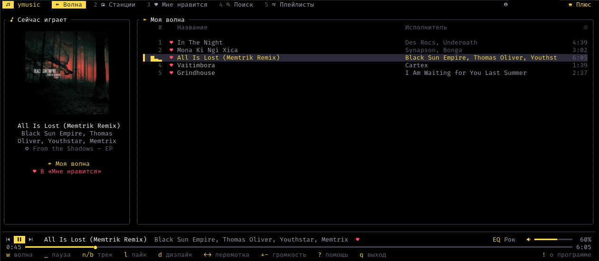
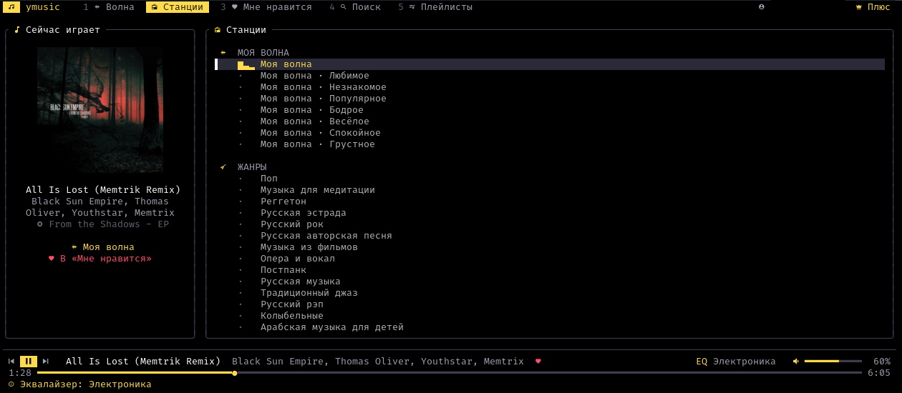
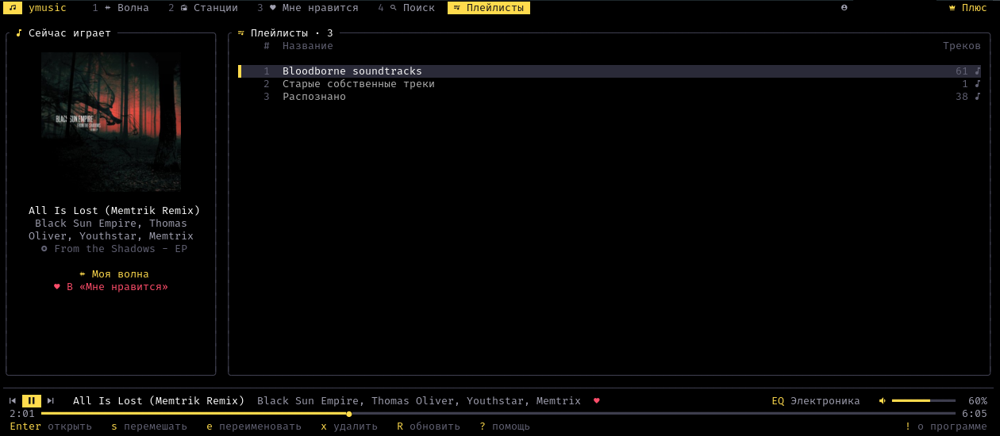
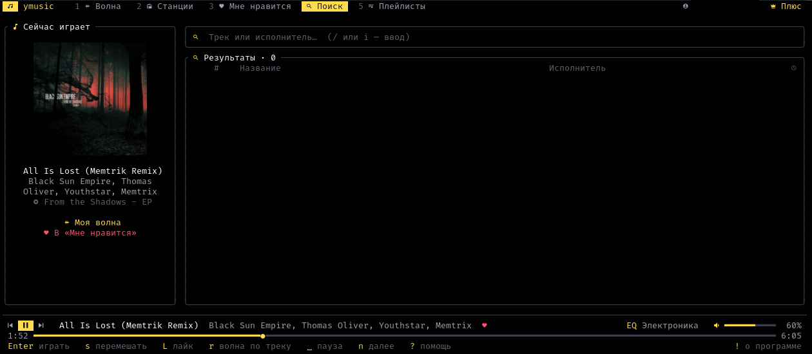
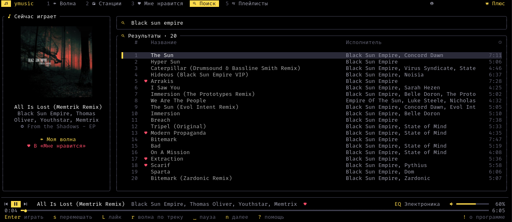
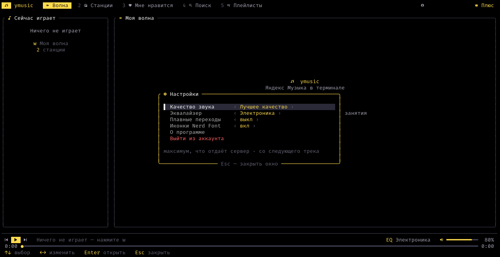
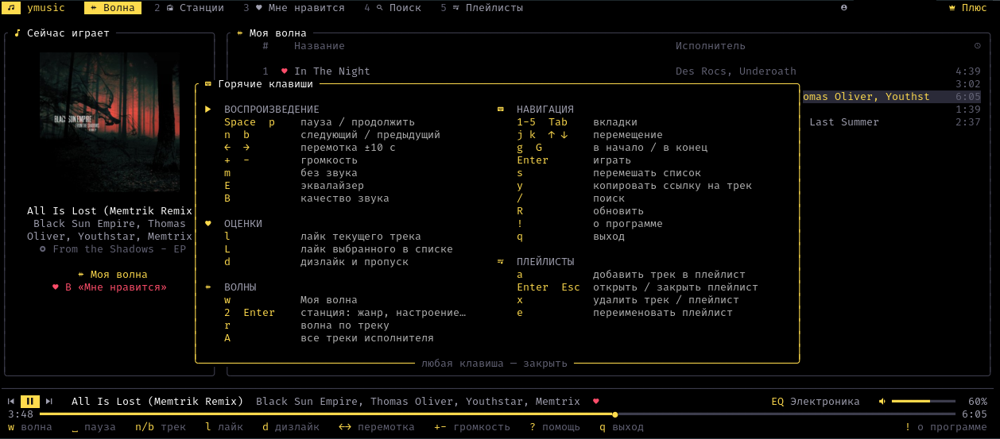

# ymusic-cli

**Яндекс Музыка в терминале для Linux и macOS.** Моя волна, поиск, плейлисты и подкасты;
звук без потерь, медиаклавиши и управление с клавиатуры.

Для прослушивания полных треков нужна подписка **Яндекс Плюс**. Приложение запускается командой `ymusic`.

<p align="center">
  
</p>

<details>
<summary>Другие экраны: станции, плейлисты, поиск и настройки</summary>

<table>
  <tr>
    <td align="center"><br><sub>Вкладка «Станции»</sub></td>
    <td align="center"><br><sub>Вкладка «Плейлисты»</sub></td>
  </tr>
  <tr>
    <td align="center"><br><sub>Вкладка «Поиск» без результатов</sub></td>
    <td align="center"><br><sub>Вкладка «Поиск» с результатами</sub></td>
  </tr>
  <tr>
    <td align="center"><br><sub>Окно настроек</sub></td>
    <td align="center"><br><sub>Окно помощи</sub></td>
  </tr>
</table>

</details>

[Возможности](#возможности) · [Установка](#установка) · [Первый запуск](#первый-запуск) ·
[Управление](#управление) · [Настройки](#настройки) · [Планы](#планы)

## Возможности

- **Моя волна и станции.** Персональные рекомендации, выбор жанра, настроения, занятия или эпохи,
  а также волна по выбранному треку. Лайки, дизлайки и пропуски учитываются в рекомендациях.
- **Музыкальная библиотека.** «Мне нравится», поиск с подгрузкой результатов, альбомы и треки исполнителя.
  Плейлисты можно создавать, переименовывать, удалять и редактировать; загруженные в аккаунт треки тоже доступны.
- **Подкасты.** Избранные шоу, новые выпуски, поиск, описания и лайки выпусков. Воспроизведение продолжается
  с позиции, сохранённой в аккаунте. В очередь можно добавлять все загруженные выпуски списка или только выбранный.
- **Звук.** Экономия трафика, обычное качество или FLAC без потерь. Если FLAC недоступен,
  используется доступное качество. Есть эквалайзер, повтор, случайный порядок и плавные переходы между треками.
- **Интерфейс.** Обложки или спектр звука, заголовок окна с названием трека, иконки или обычные символы.
- **Системное управление.** Медиаклавиши и виджеты плеера через MPRIS в Linux и «Исполняется» в macOS.
  Для кнопок Bluetooth-наушников в Linux можно использовать `mpris-proxy`.
- **Last.fm.** Скробблинг и статус «Сейчас слушает», подключение через браузер в настройках.
  При региональной блокировке Last.fm потребуется VPN.

Полное описание экранов, настроек и поведения плеера — в [руководстве](docs/FEATURES.md).

## Установка

Готовые сборки доступны для **x86_64 и aarch64 (ARM64)**. Linux-версия проверяется в том числе
на Raspberry Pi 3; macOS поддерживает Intel и Apple Silicon. Внешний плеер не требуется.

### Arch Linux

В AUR есть два пакета для x86_64 — выберите один:

```bash
yay -S ymusic-cli-bin   # готовый бинарник
# или
yay -S ymusic-cli       # сборка из исходников
```

### macOS и Linux: Homebrew

```bash
brew install iodnoorov/tap/ymusic
```

Homebrew устанавливает готовый бинарник подходящей архитектуры. Обновление:

```bash
brew update
brew upgrade ymusic
```

### Debian, Ubuntu и Fedora

Скачайте пакет своей архитектуры из [последнего релиза](https://github.com/iodnoorov/ymusic/releases/latest):
`.deb` для Debian/Ubuntu или `.rpm` для Fedora.

```bash
sudo apt install ./ymusic-cli_*_amd64.deb    # на ARM64 — *_arm64.deb
sudo dnf install ./ymusic-cli-*.x86_64.rpm   # на ARM64 — *.aarch64.rpm
```

Отдельного репозитория обновлений нет: новую версию устанавливают таким же способом.
Для совместного вывода звука с другими приложениями рекомендуется PipeWire или PulseAudio.

### Архив с готовым бинарником

Архивы для Linux и macOS находятся в [релизах](https://github.com/iodnoorov/ymusic/releases/latest).
Выберите свою систему и архитектуру; рядом с каждым архивом есть файл SHA256.

Установка в Linux:

```bash
V=3.9.0
A=$(uname -m)   # x86_64 или aarch64
curl -fLO "https://github.com/iodnoorov/ymusic/releases/download/v$V/ymusic-$V-$A-linux.tar.gz"
curl -fLO "https://github.com/iodnoorov/ymusic/releases/download/v$V/ymusic-$V-$A-linux.tar.gz.sha256"
sha256sum -c "ymusic-$V-$A-linux.tar.gz.sha256"
tar xzf "ymusic-$V-$A-linux.tar.gz"
install -Dm755 "ymusic-$V-$A-linux/ymusic" ~/.local/bin/ymusic
```

Убедитесь, что `~/.local/bin` входит в `PATH`. Для обновления повторите установку с новым номером версии.

Для macOS выберите архив `…-x86_64-macos.tar.gz` (Intel) или `…-aarch64-macos.tar.gz` (Apple Silicon).
Проверить его можно командой `shasum -a 256 -c <имя-архива>.sha256`.
Если macOS заблокировала скачанный бинарник из-за карантина, после проверки архива снимите эту отметку:

```bash
xattr -d com.apple.quarantine ./ymusic
```

### Сборка из исходников

Нужны Rust **1.89 или новее** и компилятор C++. В macOS предварительно установите Command Line Tools:
`xcode-select --install`.

Установка версии 3.9.0 через Cargo:

```bash
cargo install --locked --git https://github.com/iodnoorov/ymusic --tag v3.9.0 ymusic-cli
```

Чтобы собрать текущую версию из репозитория:

```bash
git clone https://github.com/iodnoorov/ymusic
cd ymusic
cargo build --locked --release
./target/release/ymusic
```

<details>
<summary>Сборка локальной копии в пакет Arch Linux</summary>

Из корня склонированного репозитория:

```bash
cd packaging/local
makepkg -si
```

Удаление установленного пакета: `sudo pacman -R ymusic-cli`.

</details>

## Первый запуск

Запустите `ymusic`. Если вход ещё не выполнен, появится меню авторизации:

1. **Через браузер.** Откроется отдельное окно со страницей Яндекса. Войдите привычным способом — пароль,
   QR-код или Яндекс ID. Программа получит токен и закроет окно. Используется временный профиль,
   основной профиль браузера не затрагивается.
2. **По токену.** Вставьте OAuth-токен или URL, содержащий `access_token=`.

Меню можно открыть отдельно командой `ymusic login`. Используется браузер по умолчанию;
другой можно указать через `YMUSIC_BROWSER`.

```bash
ymusic login --browser                 # вход через браузер без меню
YMUSIC_BROWSER=chromium ymusic login   # выбрать браузер для входа
ymusic login --token '<токен>'          # вход по готовому токену
ymusic whoami                         # проверить аккаунт
ymusic logout                         # выйти из аккаунта
```

Поддерживаются браузеры на основе Chromium и Firefox. Подробности — в
[руководстве](docs/FEATURES.md#командная-строка).

<details>
<summary>Как получить токен вручную</summary>

Откройте <https://oauth.yandex.ru/authorize?response_type=token&client_id=23cabbbdc6cd418abb4b39c32c41195d>
и войдите в аккаунт. Браузер перейдёт на адрес `https://music.yandex.ru/#access_token=...&token_type=bearer...`.
Токен — значение между `access_token=` и `&`.

Можно передать его только на один запуск, без сохранения:

```bash
YMUSIC_TOKEN='<токен>' ymusic
```

</details>

## Управление

```bash
ymusic                       # открыть интерфейс
ymusic --wave                # сразу включить Мою волну
ymusic --station genre:metal  # запустить станцию
ymusic --no-icons            # обычные символы вместо иконок Nerd Font
```

Вкладки: **1** — волна, **2** — станции, **3** — «Мне нравится», **4** — поиск,
**5** — плейлисты, **6** — подкасты. `Tab` и `Shift+Tab` переключают вкладки по кругу.

### Основные клавиши

| Клавиша | Действие |
|---------|----------|
| `↑` / `↓`, `j` / `k` | перемещение по списку |
| `g` / `G` | начало / конец списка |
| `Enter` | играть выбранное или открыть список выпусков / плейлист |
| `Space` / `p` | пауза / продолжить |
| `n` / `b` | следующий / предыдущий трек |
| `←` / `→` | перемотка на 10 секунд |
| `+` / `-`, `m` | громкость; выключить / включить звук |
| `w`, `r` | Моя волна; волна по выбранному или текущему треку |
| `l` / `L` | лайк текущего / выбранного трека или выпуска |
| `d` | дизлайк трека и переход к следующему |
| `s`, `T` | случайный порядок текущего списка; режим повтора |
| `/`, `R` | поиск; обновление данных аккаунта |
| `A`, `e` | треки исполнителя; альбом |
| `y`, `Y` | скопировать ссылку; играть по ссылке на трек, альбом или плейлист |
| `N`, `a` | создать плейлист; добавить трек в плейлист |
| `E`, `x` | переименовать плейлист; удалить плейлист или трек из него |
| `Esc` | закрыть окно или вернуться к предыдущему списку |
| `o`, `?`, `q` | настройки; справка; выход |

В терминалах с kitty keyboard protocol сочетания работают по физическим клавишам независимо
от раскладки и Caps Lock. В остальных доступны английская и русская раскладки.

### Подкасты

На вкладке `6` разделы «Мои», «Новые выпуски» и «Поиск» переключаются клавишами `[` / `]`.

| Клавиша | Действие |
|---------|----------|
| `Enter` на шоу | открыть выпуски |
| `Enter` на выпуске | продолжить с сохранённой позиции |
| `z` | слушать выбранный выпуск с начала |
| `I` | открыть / закрыть описание |
| `f` | добавить шоу в «Мои» или убрать из них |
| `l` / `L` | лайк текущего / выбранного выпуска |

После естественного конца выпуска воспроизведение останавливается; перейти к следующему можно клавишей `n`.
Подкасты не отправляются в Last.fm. Режим «Добавлять подкасты» в настройках определяет,
попадёт в очередь весь загруженный список или только выбранный выпуск.

Полный список сочетаний доступен по `?` и в [руководстве](docs/FEATURES.md#все-горячие-клавиши).

## Настройки

Нажмите `o`, выберите пункт стрелками `↑` / `↓` и измените значение через `←` / `→`.
Выбор запоминается между запусками. Качество звука применяется при загрузке новых треков.

В настройках доступны:

- качество звука, эквалайзер, плавные переходы и устройство вывода;
- повтор, добавление выпусков подкастов и режим «Доигрывать трек» — новый список начнётся после текущего трека;
- обложка или спектр, иконки, обратный отсчёт времени и скрытие аккаунта в заголовке;
- Last.fm, «Меньше ИИ-музыки» и выбор API — мобильного или сайта, если один из них работает нестабильно.

Токен и настройки хранятся в `~/.config/ymusic/config.json` (или `$XDG_CONFIG_HOME/ymusic/config.json`),
права файла — `0600`. Если редактируете конфиг вручную, сначала закройте приложение:
при выходе оно сохраняет настройки. «Меньше ИИ-музыки» хранится в аккаунте Яндекса.

### Отображение в терминале

Для иконок нужен [Nerd Font](https://www.nerdfonts.com), например JetBrainsMono Nerd Font
(в Arch Linux: `pacman -S ttf-jetbrains-mono-nerd`). Без него выключите иконки в настройках
или запустите `ymusic --no-icons`.

Обложки поддерживаются через sixel, kitty и iTerm2-протоколы. В терминалах без этих протоколов
используются цветные блоки. В macOS Terminal.app обложки рисуются блоками, цвета — из 256-цветной палитры.
Вместо обложки можно включить спектр звука: `o` → «Картинка».

## Планы

- Синхронизация музыки между устройствами и восстановление очереди, трека и позиции через Ynison.
- Выбор действия после конца выпуска подкаста: остановиться или включить следующий.
- Отдельный раздел для аудиокниг.

## Дополнительная информация

Проект не связан с ООО «Яндекс» и использует неофициальный API, который может измениться.
Используйте свой аккаунт и подписку в соответствии с условиями сервиса.

Лицензия проекта — [MIT](LICENSE). Декодер FDK AAC распространяется со своей
[лицензией](LICENSE-FDK-AAC); её текст включён в архивы и пакеты.
